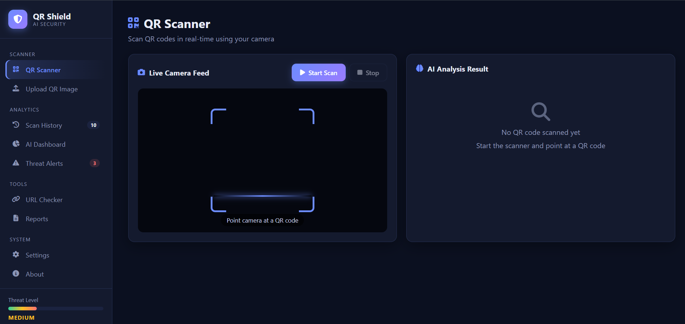
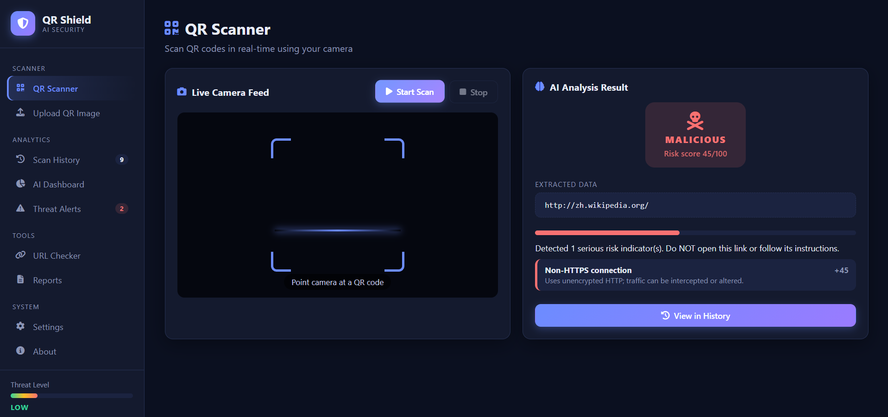
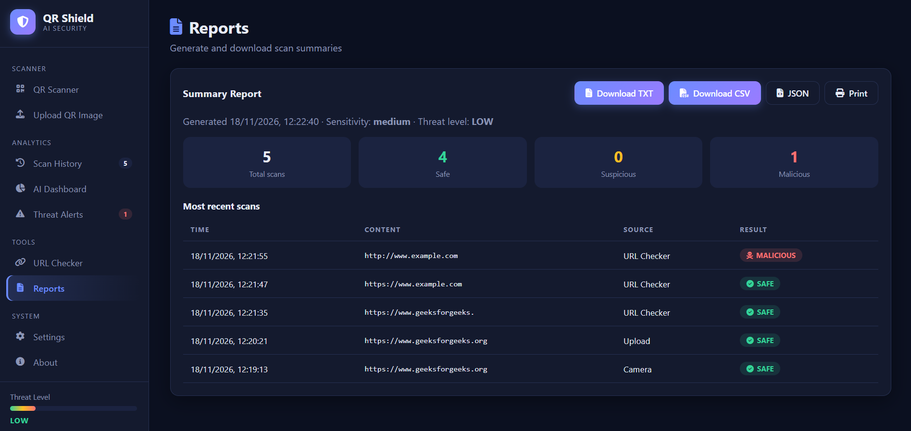
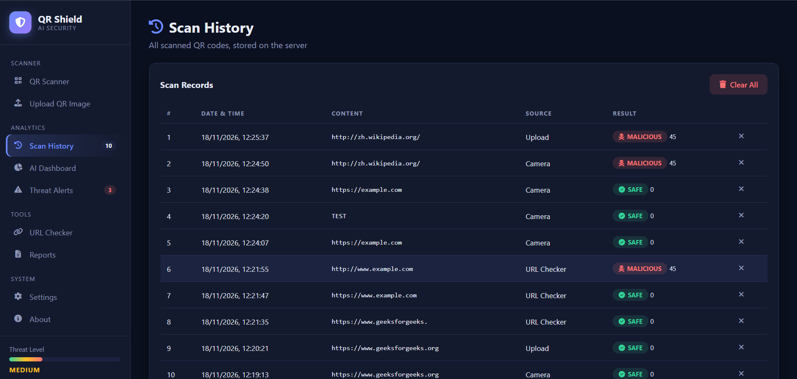
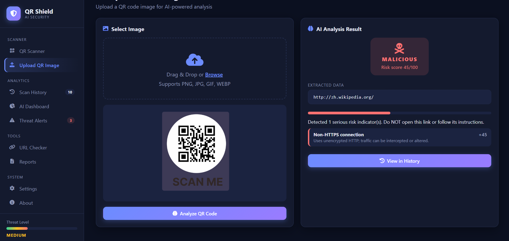
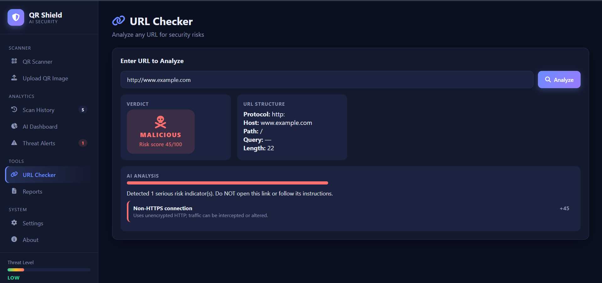

# QR Shield – AI-Based QR Attack Detection

QR Shield is a web-based security application designed to identify potentially malicious QR codes before users access harmful websites. It scans QR codes, extracts URLs, analyzes suspicious patterns and classifies potential threats into three categories: **Safe, Suspicious, and Malicious**.

The application provides a user-friendly dashboard with QR scanning, URL analysis, threat alerts, scan history and downloadable security reports.

## Key Features

- **QR Code Scanning:** Scan QR codes using a live camera or upload a QR code image.
- **URL Analysis:** Analyze extracted URLs and identify potentially harmful patterns.
- **Threat Classification:** Classify scanned content as Safe, Suspicious or Malicious.
- **Rule-Based Threat Detection:** Evaluate URLs using security rules and threat-scoring techniques.
- **Security Dashboard:** View scan statistics and security information.
- **Threat Alerts:** Identify and display suspicious and malicious scan results.
- **Scan History:** View previously scanned QR codes and their analysis results.
- **Downloadable Reports:** Export scan reports in TXT, CSV and JSON formats.
- **Standalone Mode:** Run the frontend independently without starting the backend server.

## Application Screenshots

### 1. Dashboard

### 2. QR Scanner

### 3. Reports

### 4. Scan History

### 5. Upload Images

### 6. URL Checker

## Technologies Used

| Technology | Purpose |
|---|---|
| HTML | Application structure |
| CSS | User interface and styling |
| JavaScript | Frontend functionality |
| Node.js | Server-side runtime |
| Express.js | Backend API |
| JSON | Data storage |
| Rule-Based Analysis | URL threat detection |

## Project Setup and Installation

Follow these steps to run QR Shield locally.

### 1. Install Node.js

Download and install Node.js 18 or above.

https://nodejs.org/

Verify the installation:

bash
node -v
npm -v

### 2. Open the Project

- Extract the project folder if it is compressed.
- Open Visual Studio Code.
- Select **File → Open Folder**.
- Choose the QR Shield project folder.

### 3. Install Dependencies

Open the VS Code terminal and execute:

bash
npm install

This installs the required project dependencies.

### 4. Start the Application

Run:

bash
npm start

The terminal should display:

text
QR Shield running at http://localhost:3000

### 5. Open the Application

Open Chrome or Edge and visit:

http://localhost:3000

The QR Shield application should now be running.

### 6. Run Automated Tests (Optional)

Execute:

bash
npm test

This runs the 26 automated checks included in the project.

### 7. Stop the Server

Press `Ctrl + C` in the terminal to stop the application.

## Project Structure

text
qr-shield-final/
│
├── server.js
│   └── Express backend API
│
├── analyzer.js
│   └── Rule-based threat scoring engine
│
├── package.json
│   └── Project dependencies and scripts
│
├── package-lock.json
│   └── Dependency version information
│
├── public/
│   └── index.html
│       └── Frontend application
│
├── test/
│   └── run-tests.js
│       └── Automated tests
│
├── data/
│   └── Runtime-generated scan history and settings
│
└── README.md
    └── Project documentation

## API Endpoints

The backend provides the following API endpoints:

| Method | Endpoint | Purpose |
|---|---|---|
| POST | `/api/analyze` | Analyze decoded QR content and save results |
| POST | `/api/upload` | Upload and analyze a QR code image |
| POST | `/api/url` | Analyze a directly entered URL |
| GET | `/api/history` | Retrieve scan history |
| DELETE | `/api/history/:id` | Delete a specific scan |
| DELETE | `/api/history` | Clear scan history |
| GET | `/api/stats` | Retrieve dashboard statistics |
| GET | `/api/alerts` | Retrieve threat alerts |
| GET | `/api/settings` | Retrieve detection sensitivity settings |
| PUT | `/api/settings` | Update detection sensitivity |
| GET | `/api/report?format=txt/csv/json` | Download scan reports |

## Standalone Mode

QR Shield also supports standalone operation.

- Open `public/index.html` directly in a web browser.
- The application performs analysis in the browser.
- Scan history is stored using browser storage.
- The backend server is not required in this mode.

**Note:** Camera scanning requires `localhost` or an HTTPS connection, along with browser camera permission.

## Security Considerations

- Scanned URLs are analyzed without being opened by the backend server.
- The server does not directly visit scanned URLs during analysis.
- Suspicious URL patterns are evaluated using the rule-based detection engine.

## Important Notes

- An internet connection is required for external icon, chart and QR-scanning libraries loaded through CDNs.
- Camera access requires browser permission.
- The application can operate in both server-based and standalone modes.

## Future Enhancements

- Improve threat detection accuracy.
- Integrate advanced machine learning-based threat analysis.
- Expand malicious URL detection capabilities.
- Improve security reporting and monitoring.

## Author

**Hindu Seshadri**

Computer Science and Engineering Student

GitHub: https://github.com/hinduseshadri-cmd

**Project:** QR Shield – AI-Based QR Attack Detection for Mobile Security